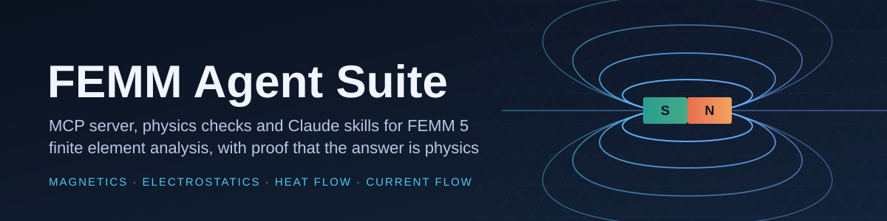
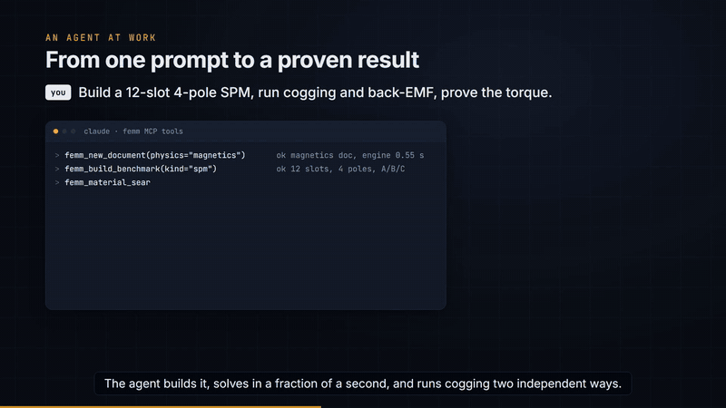

<!-- mcp-name: io.github.Zwl20085/femm-agent-suite -->
<div align="center">



# FEMM Agent Suite

**Let an AI agent build, solve, sweep and verify FEMM 5 models in magnetics, electrostatics, heat
flow and current flow, and show you the physics checks that prove each number.**

[](https://github.com/Zwl20085/femm-agent-suite/actions/workflows/tests.yml)


</div>

---

**Contents:** [What you can ask](#what-you-can-ask) ·
[Why this exists](#why-this-exists) · [Install](#install) · [Tool groups](#tool-groups) ·
[Skills](#skills) · [Video tour](#video-tour) · [Architecture](#architecture) · [Validation](#validation) ·
[FEMM 5 facts you will hit](#femm-5-facts-you-will-hit) · [Python API](#python-api) ·
[Development](#development) · [Licence](#licence) · [Acknowledgement](#acknowledgement)

## What you can ask

> *Build a planar C-core actuator with a 1 mm gap, 200 turns at 2 A and a 20 mm stack, solve it,
> and tell me the gap flux density and the pull force. Check both against hand calculations.*

> *Here is my 12-slot / 4-pole surface-PM motor. Run cogging torque by rotating the rotor and again
> with the air-gap element, and tell me whether the two agree.*

> *Open-circuit back-EMF at 1000 rpm, Ld and Lq, and the mean torque at iq = 10 A. Is the torque
> consistent with 3/2 p psi iq?*

> *Sweep a round copper conductor from 1 Hz to 10 kHz and compare R(f) with the Bessel solution.
> Does the input power match the losses?*

> *This FEMM 4.2 Lua script uses "M-19 Steel" and "NdFeB 32 MGOe". Run it on FEMM 5, port it to
> Python, and tell me which materials changed.*

The agent uses the MCP tools and the skill family below. Every tool answers with
`{"ok", "result" | "error": {"message", "hint"}, "session", "seconds"}`, errors carry the next
action as a hint, and the skills teach the agent to back each number with a health check and an
analytic estimate before calling it a result.

<table><tr>
<td width="50%"></td>
<td width="50%"></td>
</tr><tr>
<td align="center"><sub>C-core actuator built and swept by the suite. Gap B 0.238 T vs 0.2405 T analytic; force from the
weighted stress tensor and from virtual work agree within 1.6 % RMS over 1-3 mm.</sub></td>
<td align="center"><sub>12-slot / 4-pole SPM, open-circuit |B| rendered headless from the mesh arrays. Mean torque at
iq = 10 A 1.415 N·m vs 1.428 N·m from dq; cogging 0.3824 vs 0.3835 N·m by two independent routes.</sub></td>
</tr></table>

## Why this exists

FEMM is the finite element program a generation of engineers learned magnetics with. **FEMM 5**
(femm-qt, by David Meeker) is the first FEMM with cross-platform scripting: a Qt build for Windows,
macOS and Linux, a headless engine, and a plain TCP protocol that any language can speak, with
MicroPython inside the engine instead of Lua 4.

An agent still cannot just "call FEMM". It needs:

- **validated building blocks**: tools that put arguments in the right order for each physics (the
  12-argument `mi_addboundprop`, the frequency that moves position between `mi_probdef` and
  `ci_probdef`), save before analysing, handle stateful selections, and turn every FEMM error into
  an actionable hint;
- **physics checks**: energy and coenergy identities, force and torque by two methods, AC power
  balance, flux conservation, saturation, boundary distance, magnet operating points, plus 25
  closed-form estimates to compare against;
- **a catalog**: all 677 FEMM 5 scripting commands with arguments, return values and code tables,
  the four material libraries, and a record of FEMM 5 behaviour verified live.

This suite is meant as the golden-standard library a future finite element workflow can build on:
an [MCP](https://modelcontextprotocol.io) server with 89 tools, a pure-Python engineering layer
(health rules, estimates, experiments, file parser), and eleven
[Claude skills](https://docs.claude.com/en/docs/claude-code/skills) that teach the agent how a
FEMM user works and when not to trust a number.

## Install

**Requirements:** [FEMM 5.0](https://www.femm.info/doku/doku.php?id=download5) (build 06oct2026 or
newer), Python 3.10 or newer, and Claude Code or any MCP client. FEMM itself is not bundled.

**Windows**

```powershell
git clone https://github.com/Zwl20085/femm-agent-suite
cd femm-agent-suite
.\scripts\install.ps1                       # venv + package, MCP server "femm", the 11 skills
.\scripts\install.ps1 -FemmDir "D:\femm-qt\bin"   # if FEMM is not in a default location
```

**macOS / Linux**

```bash
git clone https://github.com/Zwl20085/femm-agent-suite
cd femm-agent-suite
./scripts/install.sh                        # same steps
FEMM_DIR=~/.local/opt/femm-qt/bin ./scripts/install.sh
```

Restart Claude Code and ask: *run the FEMM self-test*. It solves an axisymmetric thick solenoid
and compares the centre field with the closed form (0.7 % on build 06oct2026), and checks
materials, units, bulk getters and circuits.

<details>
<summary>As a Claude Code plugin, manual setup, other MCP clients, environment variables</summary>

**Plugin** (the plugin starts the server with [uv](https://docs.astral.sh/uv/)):

```
/plugin marketplace add Zwl20085/femm-agent-suite
/plugin install femm@femm-agent-suite
```

**Manual registration** with any Python 3.10+ that has the package installed
(`pip install -e .` in the clone):

```bash
claude mcp add femm -- <python> -m femm_agent
claude mcp add femm -e FEMM_DIR=/path/to/femm-qt/bin -- <python> -m femm_agent
```

Copy `.claude/skills/*` to `~/.claude/skills/` to install the skills by hand.

**Other MCP clients** (stdio):

```json
{"mcpServers": {"femm": {"command": "<python>", "args": ["-m", "femm_agent"],
                         "env": {"FEMM_DIR": "C:/femm-qt/bin"}}}}
```

The console script `femm-mcp` is the same server.

| Variable | Meaning | Default |
|---|---|---|
| `FEMM_DIR` | FEMM 5 bin folder (holding `femm_headless`) | auto: `C:\femm-qt\bin`, `/Applications/femm_gui.app/Contents/MacOS`, `~/.local/opt/femm-qt/bin`, `/opt/femm-qt/bin`, or `femm_headless` on PATH |
| `FEMM_AGENT_WORK` | root of the per-session work dirs (models, arrays, plots, reports) | `~/femm-agent-work` |

</details>

## Tool groups

89 tools in 12 groups. One line per tool: [`.claude/skills/femm/references/tool-map.md`](.claude/skills/femm/references/tool-map.md).

| Group | Tools | Headline tools |
|---|---:|---|
| session | 6 | `femm_status`, `femm_session_open`, `femm_selftest` |
| document | 7 | `femm_new_document`, `femm_open`, `femm_save`, `femm_problem_define` |
| geometry | 18 | `femm_draw_polygon`, `femm_add_arcs`, `femm_select`, `femm_copy_selected`, `femm_import_dxf`, `femm_geometry_summary` |
| properties | 10 | `femm_add_block_label`, `femm_add_boundary`, `femm_add_circuit`, `femm_add_conductor` |
| materials | 6 | `femm_material_search`, `femm_material_load`, `femm_material_add`, `femm_material_add_bh` |
| mesh and solve | 4 | `femm_solve`, `femm_create_mesh`, `femm_smartmesh` |
| post-processing | 10 | `femm_point_values`, `femm_block_integral`, `femm_circuit_results`, `femm_field_stats`, `femm_gap_results`, `femm_make_plot` |
| scripting | 6 | `femm_call`, `femm_eval`, `femm_run_script`, `femm_run_lua`, `femm_export_pyfemm_script` |
| docs | 5 | `femm_api_search`, `femm_api_get`, `femm_manual_section`, `femm_facts` |
| experiments | 9 | `femm_experiment_cogging`, `femm_experiment_torque_vs_angle`, `femm_experiment_backemf`, `femm_experiment_inductance`, `femm_experiment_ac_sweep`, `femm_build_benchmark` |
| health | 3 | `femm_estimate`, `femm_check_rule`, `femm_units_convert` |
| report | 5 | `femm_health_check`, `femm_report`, `femm_compare_results`, `femm_plot_field`, `femm_file_summary` |

Anything without a curated tool is one `femm_call` away; the call is checked against the
677-command catalog first.

## Skills

Eleven skills in [`.claude/skills/`](.claude/skills/). The router `femm` is the entry point and
states the safety rules; each specialised skill has `references/` for depth.

| Skill | Use it for |
|---|---|
| `femm` | Start here: which skill next, safety rules, tool map, FEMM 5 vs 4.2, self-check tasks |
| `femm-magnetics` | The core loop for magnetostatic and AC problems: boundaries, the air-gap element recipe, circuits, the feedback ladder |
| `femm-electrostatics-thermal-currentflow` | The other three physics: probdef, conductors, boundary types, point-value layouts, integral codes |
| `femm-geometry` | Drawing, selection by coordinates, groups, copy/rotate for slots and poles, DXF, symmetry, meshing failures |
| `femm-materials` | Library search, the FEMM 4.2 rename map, B-H curves, magnets, laminations, MS/m vs S/m |
| `femm-experiments` | Force vs position, torque vs angle, cogging by two routes, back-EMF, Ld/Lq, AC sweep, parametric, magnet operating point |
| `femm-health-check` | Every health rule, its tolerance, the 25 estimates, how to report PASS / FAIL / CHECK |
| `femm-postprocess` | Point values, block and line integral codes, bulk arrays, field statistics, plots, reports, comparisons |
| `femm-scripting` | `femm_call`, MicroPython scripts, batch runs, Lua 4, exporting pyFEMM scripts, migration from 4.2 |
| `femm-machine-design` | Slot/pole choice, winding factor, magnet load line, Carter, dq torque, and a parametrised SPM model in one call |
| `femm-troubleshooting` | Every error hint, engine and port problems, GUI vs headless, results that look wrong |

## Video tour

A 109-second narrated introduction to the suite: the problem, the architecture, an agent building and
proving a 12-slot / 4-pole motor, the validation table, the skills and the install.

<div align="center">
<a href="docs/video/femm-agent-suite-intro.mp4"></a>
<br><sub><a href="docs/video/femm-agent-suite-intro.mp4">Watch the full video (MP4, 1080p, 9.9 MB)</a>. Sources and re-render notes in <a href="video/README.md">video/</a>.</sub>
</div>

## Architecture

```
MCP client (Claude Code, ...)
   |  stdio
   v
femm_agent.server  ---- 12 tool groups, 89 tools, envelope {ok, result | error{message, hint}}
   |-- sessions.py      named FEMM engines: port, pid, physics, open document, solved flag, work dir
   |     `-- ipc.py     FemmLink: TCP 127.0.0.1, one MicroPython line per request, reply parsing,
   |                    timeouts, journal of every line sent (no pyFEMM import needed)
   |-- catalog.py       data/commands.json: 677 commands, arguments, returns, code tables
   |-- materials.py     data/materials/*.json + the installed .dat libraries, 4.2 rename map
   |-- experiments.py   force-position, torque-angle, cogging, back-EMF, inductance, AC sweep, parametric
   |-- health.py        pure physics invariants (unit tested)    diagnostics.py  live health check
   |-- estimate.py      25 closed-form references                units.py        conversions
   |-- benchmarks.py    validated models: ccore, coilgun, spm, round_wire
   `-- femfile.py, plotting.py, reporting.py   file parser, field maps, Markdown reports
                         |
                         v  TCP, one engine per session
              femm_headless(w) --port N   or   femm_gui --port N
              (FEMM 5: MicroPython engine, tangle mesher, fkn / belasolv / hsolv / csolv solvers)
```

Each session spawns its own headless engine on a free port (launch about 0.5 s), so several models
can run side by side. Bulk results (whole-mesh nodes, elements, B) are written to `.npz`/`.csv` in
the work dir and summarised; they never flood the agent's context.

## Validation

Measured live on FEMM 5.0 build 06oct2026 (Windows, headless) by `examples/` and `tests/live/`.

| Case | FEMM 5 via the suite | Reference | Agreement |
|---|---|---|---|
| Thick solenoid centre field (self-test, axisymmetric, 500 turns, 1 A) | `femm_selftest` | B0 = mu0 J l ln[(b + sqrt(b^2 + l^2)) / (a + sqrt(a^2 + l^2))] | 0.695 % |
| C-core gap flux density | 0.238 T | mu0 N I / (2g + l_fe/mu_r) = 0.2405 T | 1 % (fringing) |
| C-core energy | W = W' = 1/2 L I^2 = 0.0149452 J | identity for a linear model | 0.00 % |
| C-core force at 1 mm | -9.74 N; WST vs virtual work 1.6 % RMS over 1-3 mm | 2 B^2 A / 2 mu0 = -9.21 N | 6 % (fringing, leakage) |
| SPM cogging, peak to peak | 0.3824 N·m (rotate + re-mesh) | 0.3835 N·m (air-gap element) | 0.3 % |
| SPM mean torque, iq = 10 A | 1.415 N·m | 3/2 p psi_d iq from FEM flux linkage = 1.428 N·m | 0.9 % |
| SPM back-EMF fundamental, 1000 rpm | 9.973 V (rotate) | 9.977 V (air-gap element) | 0.04 % |
| SPM inductances | Ld 0.427 mH, Lq 0.421 mH | mutuals reciprocal | 0.4 % |
| Round copper wire R(f), r = 5 mm | 1 Hz - 10 kHz sweep | exact Bessel internal impedance | 0.0 % to 100 Hz, 0.1 % at 1 kHz, 1.3 % at 10 kHz |
| AC power balance | 1/2 Re(V conj I) | block-integral total losses | 0.00 % |
| Parallel-plate capacitor, heat-flow slab, current-flow strip | charge and energy, heat flux, current density | eps A / d, k dT / L, sigma V / L | within 1 % |

The C-core inductance (7.47 mH vs 4.81 mH from the no-fringing formula) is the reminder that a
formula is a reference, not a target: the skills teach the agent to explain the gap, not to tune
it away.

## FEMM 5 facts you will hit

- **Material names changed.** `M-19 Steel` is `M-19 14 mil`, `Pure Iron` is `ARMCO Pure Iron`,
  `1010 Steel` is `1010 Steel (hot rolled)`, and `NdFeB 32 MGOe` has no entry (nearest `N33`).
  FEMM raises `Couldn't load "..." from the materials library`; `femm_material_search` maps the old
  names.
- **Commands exist only with a document.** `mi_*` appears after `newdocument(0)`, `mo_*` only after
  a solution is loaded, and `mi_analyze` refuses an unsaved model.
- **One line per request.** Multi-line MicroPython goes through `exec(open(path).read())`; lines
  over 64 KiB are split by the engine.
- **One client per engine, and the engine dies with it.** A second connection gets
  `femm-qt is already connected to another client`; a headless engine exits within about 0.5 s of
  its client disconnecting.
- **No screenshots headless.** `mo_savebitmap` succeeds but writes nothing without the GUI; the
  suite renders field maps from the bulk mesh arrays instead.
- **The air-gap element needs a `<No Mesh>` annulus**, the stress-tensor block integral reads about
  zero across it (use `mo_gapintegral`), and an unknown boundary name returns zeros, not an error.
- **pyFEMM helpers are not engine commands.** `mo_getb` and 61 other conveniences answer
  `name 'mo_getb' isn't defined`; use `mo_getpointvalues` (14 values). Standalone pyFEMM finds the
  engine only through `FEMM_DIR`.
- **Units.** Magnetic current density is in MA/m^2, magnetic conductivity in MS/m, current-flow
  conductivity in S/m; the post-processor reports depth in metres, the pre-processor in problem
  units.

All verified behaviour is collected in [`docs/femm5-facts.md`](docs/femm5-facts.md) and served to
the agent by `femm_facts`.

## Python API

The engineering layer works without an MCP client. From `examples/ccore/run_ccore.py`:

```python
from pathlib import Path
from femm_agent import benchmarks, diagnostics, experiments, ipc

out = Path("out").resolve()
out.mkdir(exist_ok=True)
link = ipc.launch(port=ipc.pick_free_port(49700), cwd=str(out))   # headless FEMM 5 engine
try:
    model = (out / "ccore.fem").as_posix()
    meta = benchmarks.build_ccore(link, model)                    # validated C-core benchmark
    link.call("mi_analyze", 1)
    link.call("mi_loadsolution")
    x, y = meta["probe_gap_point"]
    print("gap B", abs(link.call("mo_getpointvalues", x, y)[2]), "T",
          "analytic", meta["estimate"]["gap_B_T"])
    hc = diagnostics.run(link, model, force_groups=[1], reaction_groups=[2, 3])
    print(hc["summary"])
    fr = experiments.force_vs_position(link, [1], dy=0.25, steps=9,
                                       out_dir=out / "experiments", restore_path=model)
    print(fr["summary"], fr["files"]["csv"])
finally:
    link.close()                                                   # the engine exits with it
```

Full examples with reports: [`examples/ccore/run_ccore.py`](examples/ccore/run_ccore.py) and [`examples/spm_motor/run_spm.py`](examples/spm_motor/run_spm.py) (about 130 solves,
about 25 s). See [`examples/README.md`](examples/README.md).

## Development

```powershell
python -m venv .venv; .venv\Scripts\pip install -e ".[dev]"
.venv\Scripts\python -m pytest            # offline suite: a fake engine, no FEMM needed (runs in CI)
.venv\Scripts\python -m pytest -m live    # live tests against a local FEMM 5
.venv\Scripts\python -m femm_agent        # run the MCP server on stdio
```

`tests/test_tool_names.py` fails if this README or any skill names a `femm_*` tool that is not
registered. Repository layout:

| Path | What |
|---|---|
| `src/femm_agent/` | server, IPC, sessions, tool groups, engineering layer |
| `data/` | `commands.json` (677 commands), `commands_summary.md`, parsed material libraries |
| `docs/femm5-facts.md` | verified FEMM 5 behaviour, with evidence tags |
| `.claude/skills/` | the eleven skills |
| `examples/` | end-to-end C-core and SPM scripts |
| `scripts/` | installers for Windows and macOS / Linux |
| `tests/` | offline tests; `tests/live/` needs FEMM 5 |

Contributions: see [`CONTRIBUTING.md`](CONTRIBUTING.md). Only document behaviour observed on a real
FEMM 5, and mark the rest unverified.

## Support the project

On first use on a machine, `femm_status` / `femm_selftest` ask the agent to offer you a GitHub star
for this repository. It is opt-in and asked once: the agent stars it (via `gh`, else it opens the
page in your browser) only if you say yes. Answering no silences it for good; the answer is kept in
`state.json` under `FEMM_AGENT_HOME` (default `%LOCALAPPDATA%emm-agent-suite`, `~/.local/state/femm-agent-suite`).

## Licence

The suite is MIT licensed ([`LICENSE`](LICENSE)). FEMM 5 itself is not part of this repository and
is not redistributed: the femm-qt application, engine, mesher, bindings and material libraries are
MIT, and the finite element solvers (`fkn`, `belasolv`, `hsolv`, `csolv`) are GPLv3 or later. The
suite talks to FEMM over its TCP interface and does not link the solvers. The JSON summaries in
`data/` are generated from the installed FEMM 5 libraries and keep their MIT licence.

## Acknowledgement

FEMM is the work of **David Meeker**. Thank you for decades of a free, rigorous 2D field solver, and
for FEMM 5's open scripting interface that made this project possible. Get FEMM 5 from
[femm.info](https://www.femm.info): [download page](https://www.femm.info/doku/doku.php?id=download5).
This project is independent and not affiliated with or endorsed by the FEMM author.
