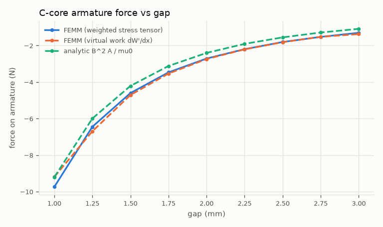
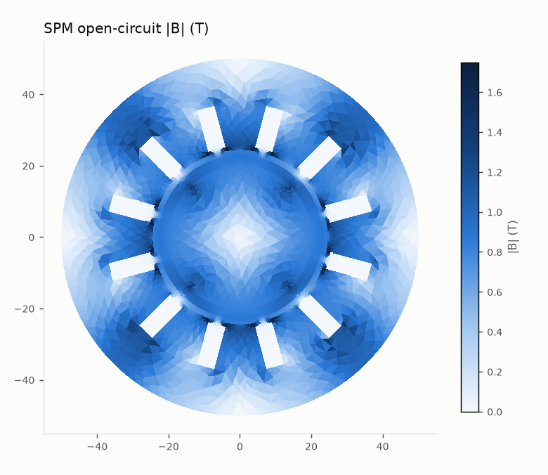

# Examples

Two end-to-end scripts that drive FEMM 5 through the suite's Python API (no MCP client needed):
build a model from scratch, solve, judge it with the health rules, run the standard experiments
and write a Markdown report. They need FEMM 5 installed (found automatically, or set `FEMM_DIR`)
and the dev install (`pip install -e ".[dev]"`, which brings numpy and matplotlib).

Outputs go to `examples/<name>/out/` (git-ignored): the models, every experiment's CSV/JSON/PNG,
and `report/report.md`.

## C-core actuator: `ccore/run_ccore.py`

```powershell
.venv\Scripts\python examples\ccore\run_ccore.py
.venv\Scripts\python examples\ccore\run_ccore.py --iron "1010 Steel (hot rolled)"   # nonlinear steel
```

A planar U-core with an I-armature (two 1 mm gaps), 200 turns, 2 A, 20 mm deep, open boundary from
`mi_makeABC`. What the script does and what it found on FEMM 5 (build 06oct2026):

| step | result | analytic reference |
|---|---|---|
| gap flux density | 0.238 T | mu0 N I / (2g + l_fe/mu_r) = 0.2405 T |
| health check | all 10 applicable rules pass (W = W' = 1/2 L I^2 to 0.00 %, left/right gap flux equal to 0.3 %) | |
| force vs gap, 1 to 3 mm (9 solves) | -9.74 N at 1 mm, WST vs virtual work within 1.6 % RMS | 2 B^2 A / 2 mu0 = -9.21 N |
| inductance | 7.47 mH | N^2 mu0 A / (2g + l_fe/mu_r) = 4.81 mH (fringing and leakage are not in the formula) |



## Surface-PM motor: `spm_motor/run_spm.py`

```powershell
.venv\Scripts\python examples\spm_motor\run_spm.py           # about 25 s, about 130 solves
.venv\Scripts\python examples\spm_motor\run_spm.py --quick
```

A 12-slot, 4-pole inner-rotor SPM machine (M-19 14 mil, N42, 50 mm outer radius, 50 mm stack,
about 9.7k elements). It is modelled twice: once with the rotor rotated and re-meshed each step,
once with FEMM 5's periodic air-gap element (`BdryFormat 6`, stepped with
`mi_modifyboundprop("AGE", 10, angle)`).

| quantity | FEMM 5 | reference |
|---|---|---|
| cogging torque, peak to peak | 0.382 N*m (rotate) / 0.384 N*m (air-gap element) | the two methods agree to 0.3 % |
| PM flux linkage, fundamental | 47.6 mWb | flat-gap estimate 51.0 mWb |
| back-EMF at 1000 rpm | 9.97 V peak, THD 27 % (full-pitch winding, full-arc magnets) | |
| Ld / Lq | 0.427 / 0.421 mH | SPM: Ld close to Lq |
| mean torque at iq = 10 A | 1.415 N*m | 3/2 p psi_d iq from the FEM flux linkages = 1.428 N*m |
| magnet operating point | B_m / Br = 0.70, Pc about 2.5 | load line: B_m = Br Pc / (Pc + mu_r) |



The same steps are available to an agent as MCP tools: `femm_build_benchmark`,
`femm_health_check`, `femm_experiment_cogging`, `femm_experiment_backemf`,
`femm_experiment_inductance`, `femm_experiment_torque_vs_angle`, `femm_experiment_bh_check`,
`femm_compare_results` and `femm_report`.
